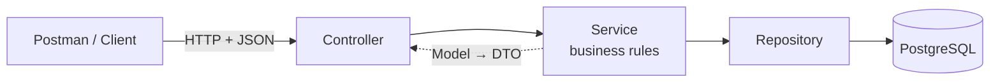
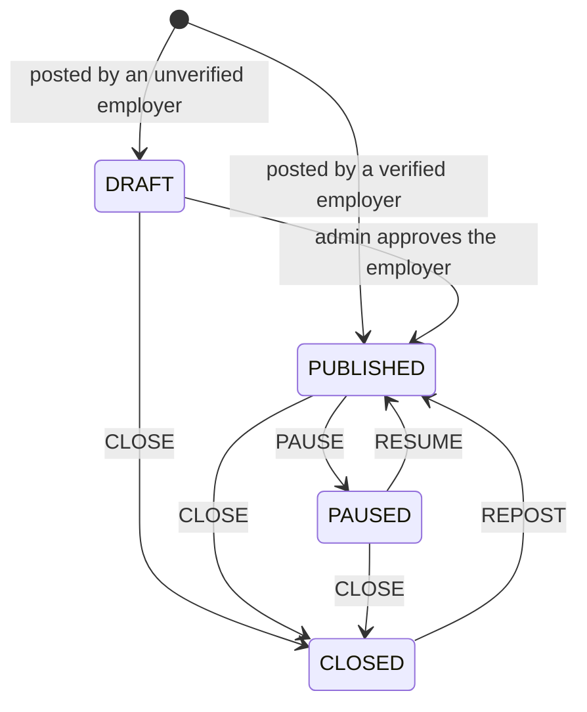
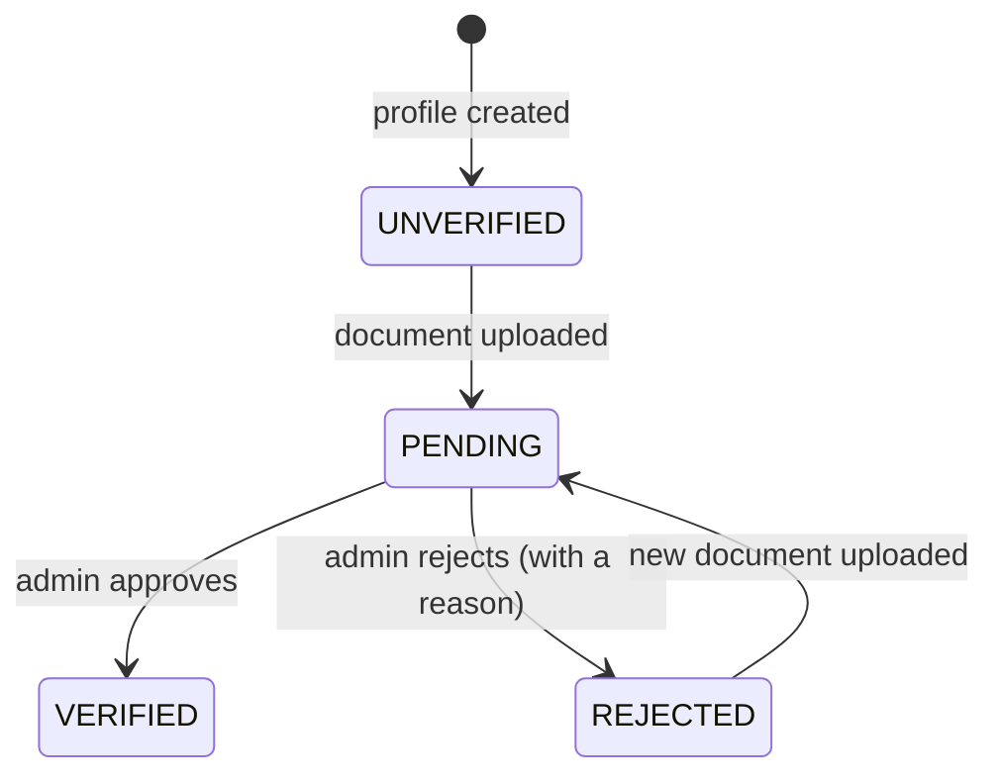

<div align="center">

# কাজ · Kaaj – The Job

### Employer & Job Post REST API

*AI job matching for everyone in Bangladesh, built voice-first and Bangla-first.*


**CSE471: System Analysis and Design** · Fall 2026 · Group 08 · Lab Assignment 03

</div>

---

## 📖 About

**Kaaj** (কাজ, "work" in Bangla) connects job seekers with verified employers.
This repository holds my individual part of the backend: the REST APIs for two features.

| # | Feature | What it does | Status |
|---|---------|--------------|--------|
| 01 | **Post and manage jobs** | Employers post a job with a required wage range, then edit, pause, close or repost it | ✅ Built |
| 02 | **Employer profile and verification** | Employers create a business profile and upload a trade licence or national ID; an admin approves or rejects it | ✅ Built |

> Only **verified** employers can publish jobs. An unverified employer's post stays a draft until an admin approves the business.

---

## ✨ Features

### Feature 01 · Post and manage jobs

An employer writes a job post and looks after it until the job is filled.

**What an employer can do**

- **Post a job** with a title in Bangla or English, a category, the number of openings, working hours, a shift and a job type (full-time, part-time or daily).
- **State the wage up front.** A wage or wage range with its period (hour, day, week, month or piece) is required; a post without one is refused.
- **Set the place** with a map pin, or mark the job as remote.
- **List the requirements:** skills, documents such as a driving licence, and minimum years of experience.
- **See all their posts**, newest first, or only those in one status.
- **Edit a post** by sending just the fields that change.
- **Pause, resume, close or repost** a post.

**How it works**

- A post is always in one of four statuses: `DRAFT`, `PUBLISHED`, `PAUSED` or `CLOSED`.
- Publishing stamps the post with `publishedAt` and an `expiresAt` date 30 days later.
- Every request names the calling employer, and an employer can only see and change their own posts.
- Each status action is allowed only from certain statuses, so a paused job cannot be paused again and a closed job must be reposted before it is edited.

| | |
|---|---|
| **Endpoints** | 5, under `/api/v1/employer/jobs` |
| **Code** | `EmployerJobController` → `JobService` → `JobRepository` → `Job` |
| **Table** | `job`, linked to `employer` by `employer_id` |
| **Tested** | All 5 in Postman, plus the wage rule (`400`) and a refused status change (`409`) |

### Feature 02 · Employer profile and verification

An employer sets up a business profile and proves the business is real; an admin checks it.

**What an employer can do**

- **Create a business profile** with the business name, its kind (household, SME, company, agency or NGO), address, map pin and contact person.
- **View and edit** the profile.
- **Upload a trade licence or national ID** as a JPEG, PNG or PDF of up to 3 MB.

**What an admin can do**

- **See the verification queue:** every employer waiting for a decision, or those in any other status.
- **Approve or reject** an employer. A rejection must come with a reason, which the employer sees on their profile.

**How it works**

- A profile moves through `UNVERIFIED` → `PENDING` (document uploaded) → `VERIFIED` or `REJECTED`.
- A rejected employer can upload a new document and return to `PENDING`.
- The uploaded file is saved on the server's disk under a random name; the API only ever says whether a document was uploaded.

| | |
|---|---|
| **Endpoints** | 6: four under `/api/v1/employer/profile`, two under `/api/v1/admin/employers` |
| **Code** | `EmployerProfileController`, `AdminEmployerController` → `EmployerService` → `EmployerRepository` → `Employer` |
| **Table** | `employer` |
| **Tested** | All 6 in Postman, with both an approval and a rejection, plus a refused second decision (`409`) |

### How the two features work together

Verification decides who can publish:

1. An **unverified** employer posts a job. It is saved as a `DRAFT`.
2. The employer uploads a document and the admin **approves** the business.
3. The draft becomes `PUBLISHED` by itself, and every post by that employer now carries `"verifiedEmployer": true`, which the app shows as a "Verified" badge.

A **verified** employer's new posts are published straight away.

---

## 🏗️ Architecture

The project follows the **MVC** pattern with a service layer.



```
src/main/java/com/example/studentapi/
├── controller/    receives HTTP requests and returns responses
│   ├── EmployerJobController.java       5 job endpoints
│   ├── EmployerProfileController.java   4 profile endpoints
│   └── AdminEmployerController.java     2 admin endpoints
├── service/       business rules (who can do what, and when)
│   ├── JobService.java
│   └── EmployerService.java
├── repository/    database access through Spring Data JPA
│   ├── JobRepository.java
│   └── EmployerRepository.java
├── model/         entities that map to database tables
│   ├── Job.java
│   └── Employer.java
└── dto/           the JSON shapes going in and out (the "View")
    ├── JobRequest.java, JobResponse.java, JobStatusChange.java
    └── EmployerRequest.java, EmployerResponse.java, VerificationDecision.java

postman/
├── Kaaj_API_Assignment_03.postman_collection.json   every request, ready to import
└── sample-trade-licence.png                         a made-up document for the upload test
```

---

## 🔌 API reference

Base URL: `http://127.0.0.1:1027/api/v1`

### Feature 01 · Post and manage jobs

| Method | Endpoint | Purpose | Headers | Body |
|--------|----------|---------|---------|------|
| `POST` | `/employer/jobs` | Post a job | `X-Employer-Id`, `Content-Type: application/json` | JSON |
| `GET` | `/employer/jobs` | List my jobs (optional `?status=`) | `X-Employer-Id` | None |
| `GET` | `/employer/jobs/{id}` | View one of my jobs | `X-Employer-Id` | None |
| `PATCH` | `/employer/jobs/{id}` | Edit a job (only the fields sent) | `X-Employer-Id`, `Content-Type: application/json` | JSON |
| `PATCH` | `/employer/jobs/{id}/status` | Pause, resume, close or repost | `X-Employer-Id`, `Content-Type: application/json` | JSON |

<details>
<summary><b>Example: post a job</b></summary>

**Request** · `POST /api/v1/employer/jobs`

```json
{
  "titleBn": "পিকআপ ড্রাইভার",
  "titleEn": "Pickup Driver",
  "descriptionEn": "Drive a pickup van on delivery routes around Tongi and Gazipur.",
  "category": "Driver",
  "jobType": "FULL_TIME",
  "shift": "DAY",
  "hours": "08:00-18:00",
  "openings": 2,
  "wageMin": 16000,
  "wageMax": 20000,
  "wagePeriod": "MONTH",
  "latitude": 23.8916,
  "longitude": 90.4023,
  "minExperienceYears": 2,
  "requiredSkills": ["Pickup driving"],
  "requiredDocuments": ["Driving licence"]
}
```

**Response** · `201 Created`, with `"status": "PUBLISHED"` for a verified employer or `"status": "DRAFT"` for anyone else.

A post without a wage is refused with `400 Bad Request`: wages are always shown up front.

</details>

<details>
<summary><b>Example: change a job's status</b></summary>

**Request** · `PATCH /api/v1/employer/jobs/{id}/status`

```json
{ "action": "PAUSE" }
```

The action is `PAUSE`, `RESUME`, `CLOSE` or `REPOST`. An action that does not fit the job's current status is refused with `409 Conflict`.

</details>

### Job status flow



### Feature 02 · Employer profile and verification

| Method | Endpoint | Purpose | Headers | Body |
|--------|----------|---------|---------|------|
| `POST` | `/employer/profile` | Create the business profile | `Content-Type: application/json` | JSON |
| `GET` | `/employer/profile` | View my profile | `X-Employer-Id` | None |
| `PUT` | `/employer/profile` | Edit my profile | `X-Employer-Id`, `Content-Type: application/json` | JSON |
| `POST` | `/employer/profile/document` | Upload a verification document | `X-Employer-Id` | form-data: `file` |
| `GET` | `/admin/employers?status=PENDING` | Admin: the verification queue | None | None |
| `POST` | `/admin/employers/{id}/verification` | Admin: approve or reject | `Content-Type: application/json` | JSON |

<details>
<summary><b>Example: create a business profile</b></summary>

**Request** · `POST /api/v1/employer/profile`

```json
{
  "name": "Karim Transport",
  "kind": "SME",
  "address": "Station Road, Tongi, Gazipur",
  "latitude": 23.8916,
  "longitude": 90.4023,
  "contactPerson": "Md. Karim"
}
```

**Response** · `201 Created`

```json
{
  "id": "0193c8b0-1a2b-7c3d-8e4f-5a6b7c8d9e0f",
  "name": "Karim Transport",
  "kind": "SME",
  "address": "Station Road, Tongi, Gazipur",
  "latitude": 23.8916,
  "longitude": 90.4023,
  "contactPerson": "Md. Karim",
  "documentUploaded": false,
  "verificationStatus": "UNVERIFIED",
  "verificationNote": null,
  "verifiedAt": null
}
```

</details>

<details>
<summary><b>Example: approve or reject an employer</b></summary>

**Request** · `POST /api/v1/admin/employers/{id}/verification`

```json
{ "decision": "APPROVE" }
```

```json
{ "decision": "REJECT", "reason": "The trade licence is not readable" }
```

</details>

### Verification flow



---

## ✅ Rules the API enforces

The rules live in the service classes as plain Java, so no client can skip them.

| Rule | What happens when it is broken |
|------|--------------------------------|
| A job needs a wage or wage range, with its period | `400 Bad Request` |
| A job needs a title and a description, in Bangla or English | `400 Bad Request` |
| A job needs a map location, unless it is remote | `400 Bad Request` |
| An employer can only see and change their own jobs | `403 Forbidden` |
| A status action must fit the job's current status (for example, only a published job can be paused) | `409 Conflict` |
| A closed job cannot be edited until it is reposted | `409 Conflict` |
| Only verified employers publish; other posts wait as drafts and go live on approval | Saved as `DRAFT` |
| A business profile needs a name and a kind | `400 Bad Request` |
| The verification document must be a JPEG, PNG or PDF of up to 3 MB | `400 Bad Request` |
| Only a pending employer can be approved or rejected, and a rejection needs a reason | `409 Conflict` / `400 Bad Request` |

---

## 🚀 Getting started

**You need:** JDK 25 and PostgreSQL with a database named `student_db`.

1. **Clone the repository** and open the folder:

   ```powershell
   git clone https://github.com/ahsanauddry027/SpringBoot_PostgreSQL_Api.git
   ```

2. **Add your database password.** Create a file named `.env` in the project root:

   ```properties
   DB_PASSWORD=your-postgres-password
   ```

   This file is git-ignored, so the password never leaves your machine.

3. **Run the server:**

   ```powershell
   .\mvnw.cmd spring-boot:run
   ```

4. **Check it works:** open `http://127.0.0.1:1027/api/hello`

Hibernate creates the tables on first start, so there is no SQL to run by hand.

### Try it in Postman

Import `postman/Kaaj_API_Assignment_03.postman_collection.json` (Postman → Import). It holds every request for both features, plus a short flow that shows a draft going live when its employer is approved. The employer ids in it belong to my local database, so create your own employer first and swap in its `id`. `postman/sample-trade-licence.png` is a made-up document for testing the upload.

---

## 📝 Notes for this assignment

- The server runs on port **1027**, the last four digits of my student ID.
- There is no login in this project, so the `X-Employer-Id` header says which employer is calling. The full Kaaj app uses session-based sign-in instead.
- All 11 endpoints were tested in Postman; the collection is in `postman/`.
- Uploaded documents are saved under `data/uploads/` with random file names and are never committed.
- Errors come back as JSON `ProblemDetail` responses (RFC 9457) with a readable message.

---

<div align="center">

**Ahsan Habib** · Member 3, Group 08 · BRAC University

*Job seekers never pay.*

</div>
