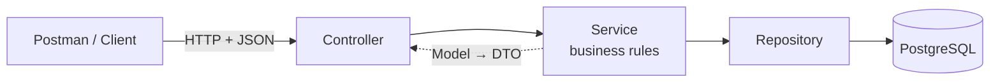
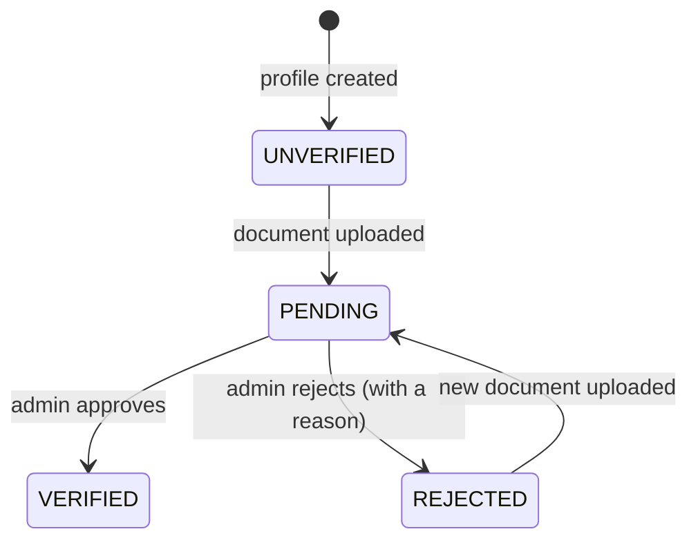

<div align="center">

# কাজ · Kaaj – The Job

### Employer & Job Post REST API

*AI job matching for everyone in Bangladesh, built voice-first and Bangla-first.*


**CSE471: System Analysis and Design** · Fall 2026 · Group 08 · Lab Assignment 03

</div>

---

## 📖 About

**Kaaj** (কাজ, "work" in Bangla) connects job seekers with verified employers.
This repository holds my individual part of the backend: the REST APIs for two features.

| # | Feature | What it does | Status |
|---|---------|--------------|--------|
| 01 | **Post and manage jobs** | Employers post a job with a required wage range, then edit, pause, close or repost it | 🚧 In progress |
| 02 | **Employer profile and verification** | Employers create a business profile and upload a trade licence or national ID; an admin approves or rejects it | ✅ Built |

> Only **verified** employers can publish jobs. An unverified employer's post stays a draft until an admin approves the business.

---

## 🏗️ Architecture

The project follows the **MVC** pattern with a service layer.



```
src/main/java/com/example/studentapi/
├── controller/    receives HTTP requests and returns responses
├── service/       business rules (who can do what, and when)
├── repository/    database access through Spring Data JPA
├── model/         entities that map to database tables
└── dto/           the JSON shapes going in and out (the "View")
```

---

## 🔌 API reference

Base URL: `http://127.0.0.1:1027/api/v1`

### Feature 02 · Employer profile and verification

| Method | Endpoint | Purpose | Headers | Body |
|--------|----------|---------|---------|------|
| `POST` | `/employer/profile` | Create the business profile | `Content-Type: application/json` | JSON |
| `GET` | `/employer/profile` | View my profile | `X-Employer-Id` | None |
| `PUT` | `/employer/profile` | Edit my profile | `X-Employer-Id`, `Content-Type: application/json` | JSON |
| `POST` | `/employer/profile/document` | Upload a verification document | `X-Employer-Id` | form-data: `file` |
| `GET` | `/admin/employers?status=PENDING` | Admin: the verification queue | None | None |
| `POST` | `/admin/employers/{id}/verification` | Admin: approve or reject | `Content-Type: application/json` | JSON |

### Feature 01 · Post and manage jobs

| Method | Endpoint | Purpose |
|--------|----------|---------|
| `POST` | `/employer/jobs` | Post a job |
| `GET` | `/employer/jobs` | List my jobs |
| `GET` | `/employer/jobs/{id}` | View one of my jobs |
| `PATCH` | `/employer/jobs/{id}` | Edit a job |
| `PATCH` | `/employer/jobs/{id}/status` | Pause, resume, close or repost |

<details>
<summary><b>Example: create a business profile</b></summary>

**Request** · `POST /api/v1/employer/profile`

```json
{
  "name": "Karim Transport",
  "kind": "SME",
  "address": "Station Road, Tongi, Gazipur",
  "latitude": 23.8916,
  "longitude": 90.4023,
  "contactPerson": "Md. Karim"
}
```

**Response** · `201 Created`

```json
{
  "id": "0193c8b0-1a2b-7c3d-8e4f-5a6b7c8d9e0f",
  "name": "Karim Transport",
  "kind": "SME",
  "address": "Station Road, Tongi, Gazipur",
  "latitude": 23.8916,
  "longitude": 90.4023,
  "contactPerson": "Md. Karim",
  "documentUploaded": false,
  "verificationStatus": "UNVERIFIED",
  "verificationNote": null,
  "verifiedAt": null
}
```

</details>

<details>
<summary><b>Example: approve or reject an employer</b></summary>

**Request** · `POST /api/v1/admin/employers/{id}/verification`

```json
{ "decision": "APPROVE" }
```

```json
{ "decision": "REJECT", "reason": "The trade licence is not readable" }
```

</details>

### Verification flow



---

## 🚀 Getting started

**You need:** JDK 25 and PostgreSQL with a database named `student_db`.

1. **Clone the repository** and open the folder.

2. **Add your database password.** Create a file named `.env` in the project root:

   ```properties
   DB_PASSWORD=your-postgres-password
   ```

   This file is git-ignored, so the password never leaves your machine.

3. **Run the server:**

   ```powershell
   .\mvnw.cmd spring-boot:run
   ```

4. **Check it works:** open `http://127.0.0.1:1027/api/hello`

Hibernate creates the tables on first start, so there is no SQL to run by hand.

---

## 📝 Notes for this assignment

- The server runs on port **1027**, the last four digits of my student ID.
- There is no login in this project, so the `X-Employer-Id` header says which employer is calling. The full Kaaj app uses session-based sign-in instead.
- Uploaded documents are saved under `data/uploads/` with random file names and are never committed.
- Errors come back as JSON `ProblemDetail` responses (RFC 9457) with a readable message.

---

<div align="center">

**Ahsan Habib** · Member 3, Group 08 · BRAC University

*Job seekers never pay.*

</div>
